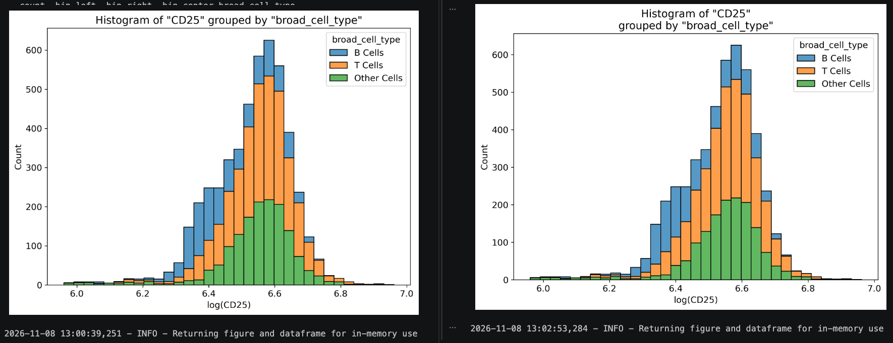
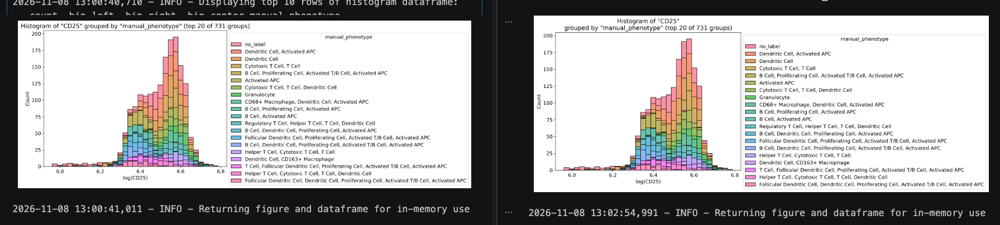
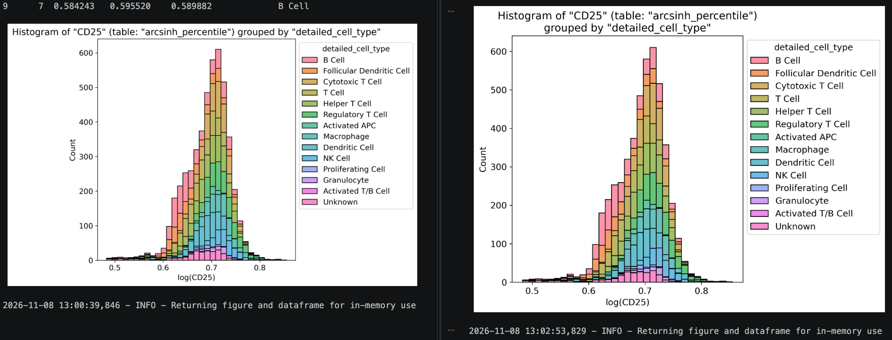
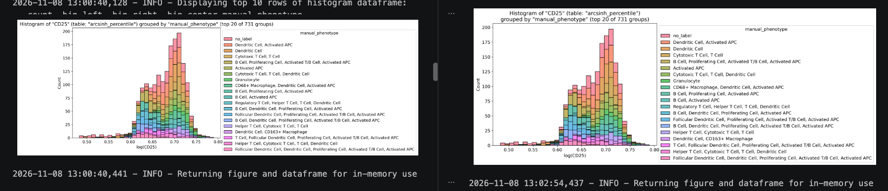
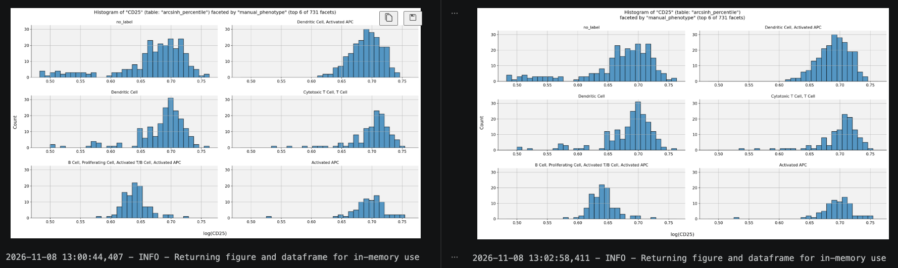

# Details for PR #434

These examples show the title layout before and after [SCSAWorkflow PR #434](https://github.com/FNLCR-DMAP/SCSAWorkflow/pull/434). The figures on the left use the previous title layout; the figures on the right use the new line break. All examples plot the `CD25` Feature.

## Original Table

### Grouped

The grouping details are separated from the Feature name.

### Grouped with filtering

The grouping and filtering details are separated together from the Feature name. This example displays the 20 most frequent groups out of 731.

## Named Table

The following examples use the `arcsinh_percentile` Table. Its name remains with the Feature name in the title.

### Grouped

### Grouped with filtering

This example displays the 20 most frequent groups out of 731.

Full-resolution images: [before](./histogram_before-wrap.png) and [after](./histogram_after-wrap.png).

## Named Table faceted with filtering

The faceting and filtering details are separated from the Feature and Table names. This example displays the 6 most frequent facets out of 731.

